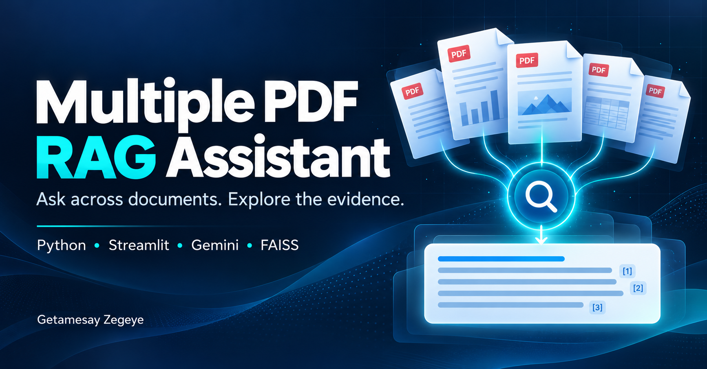

# Multiple PDF RAG Assistant



A Streamlit application by **Getamesay Zegeye** for asking questions across uploaded PDFs and inspecting the retrieved evidence.

## Features

- Multiple PDF uploads, extracted page by page with pypdf.
- 1,500-character chunks, 200-character overlap; chunks stay within a page.
- Gemini document/query embeddings with distinct retrieval task types.
- L2-normalized vectors and exact FAISS IndexFlatIP search over a shared document collection.
- Up to six retrieved chunks per question, with file names and page numbers.
- Gemini Flash-Lite answers with recent conversation history and follow-up question rewriting.
- Upload sidebar, chat tab and separate retrieved-context tab.
- Answer-specific evidence retained across reruns, with a selector for previous answers.
- Indexed-document inventory, duplicate-filename labels and clear-chat control.
- SHA-256 file-selection checks prevent questions using an index for a changed selection.
- The prior index is replaced only after successful processing.

## Run locally

Use Python 3.12 as a starting environment; dependencies are unpinned.

```bash
python -m venv .venv
```

Activate with `source .venv/bin/activate` on macOS/Linux or `.venv\Scripts\Activate.ps1` in Windows PowerShell.

```bash
python -m pip install -r requirements.txt
```

Copy `.env.example` to `.env`, set GOOGLE_API_KEY, then run:

```bash
python -m streamlit run app.py
```

Upload text-based PDFs, click **Process PDFs**, then ask a question. Both embeddings and generation use Google's API and need available quota. No API key or research PDF is included.

## Implementation boundaries

The FAISS index is in session memory; it is not saved to disk. Restarting the session requires processing again. The last three completed conversation turns are used to resolve follow-ups. A separate model request rewrites follow-ups for retrieval; both the current question and bounded history accompany answer generation. History is not treated as factual evidence. Retrieval is semantic top-6 across all PDFs; there is no hybrid retrieval, reranking, per-document coverage guarantee or relevance threshold. Scanned PDFs require OCR outside this app.

This Task 2 update extends the attached original source. Thirteen offline tests pass, including Streamlit AppTest flows, real pypdf extraction and real FAISS indexing/search with simulated Google responses. Extraction also succeeded on the supplied YOLO and Transformer research PDFs (74 chunks across 25 nonempty pages). Sample research/manual/report PDFs are generated in memory by the tests. These checks establish application behavior, not live Gemini answer quality. No live API accuracy or latency result is claimed.

## Task 2: multi-document chat

1. Upload several text-based PDFs in the sidebar and click **Process PDFs**.
2. Use **Chat** to ask a question or follow-up. Earlier chat is kept in session state.
3. Open **Retrieved context** to inspect an answer's file names, pages, passages and rewritten search question.
4. Use **Choose an answer to inspect** to revisit evidence from an earlier turn.
5. **Clear chat** removes chat and evidence while retaining the processed index.
6. A changed upload selection disables questions and hides the old chat until that selection is restored or successfully processed.

Retrieved file labels identify candidate evidence, not a guarantee that every passage contributed to the answer. Citations remain model-generated and need review. Follow-ups add a model call and can fail or resolve references incorrectly.

## Documentation

- [Technical report](docs/TECHNICAL_REPORT.md)
- [Architecture](docs/ARCHITECTURE.md)
- [Setup and troubleshooting](docs/SETUP_AND_TROUBLESHOOTING.md)
- [Evaluation plan](evaluation/EVALUATION.md)
- [Short CV entry](career/CV_Short.md)
- [Detailed CV entry](career/CV_Detailed.md)
- [LinkedIn text](career/LINKEDIN.md)
- [Portfolio case study](career/PORTFOLIO_CASE_STUDY.md)
- [30 interview questions and answers](interview/30_Interview_Questions_and_Answers.md)

Install test dependencies: `python -m pip install -r requirements-dev.txt`.

Run offline checks: `python -m unittest discover -s tests -v`.

See [Task 2 validation and manual test matrix](docs/TASK2_VALIDATION.md).

Project: https://github.com/Get-AZ/Multiple-PDF-RAG-Assistant

