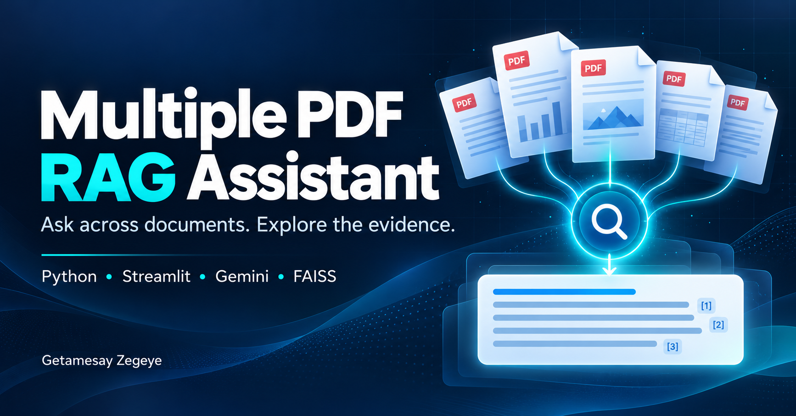

# Multiple PDF RAG Assistant



A multi-PDF question-answering project by **Getamesay Zegeye**, with a Streamlit interface, a local authenticated HTTP API, stable evidence identities and a reproducible development evaluation harness.

The service returns answers alongside the retrieved filenames, PDF pages, text and chunk IDs. Retrieved evidence is available for inspection. Deterministic filename/page diagnostics flag reference problems; semantic claim support and citation coverage still require review.

## Features

- Page-local extraction using pypdf: 1,500-character chunks with 200-character overlap.
- Stable SHA-256 document/chunk identities, text hashes and character offsets.
- Gemini document/query embeddings using separate retrieval task types.
- L2-normalized vectors and exact FAISS `IndexFlatIP` search over all PDFs in a collection.
- Up to six retrieved passages per question.
- Citation-reference diagnostics for missing filenames, unknown sources and PDF pages absent from retrieved context; no automatic claim-support judgment.
- Bounded history and a standalone-question rewrite for follow-ups.
- Streamlit upload, chat and evidence-inspection tabs using the same RAG core as the API.
- Local API for collection creation, questions and deletion, protected by a service token.
- Optional local document-embedding reuse with request counts and a cold/warm benchmark; disabled by default.
- Frozen development data, saved-response bindings and human-reviewed answer comparisons.
- GitHub Actions runs the offline test suite on pull requests to `main`.

## Install

The local Windows validation and CI use **Python 3.14**. Dependency ranges are not a fully locked environment.

From the repository root in Windows PowerShell:

```powershell
py -3.14 -m venv .venv
.\.venv\Scripts\python.exe -m pip install -r requirements-service.txt reportlab
```

For an existing environment, skip virtual-environment creation. On macOS/Linux, use `python3 -m venv .venv` and `.venv/bin/python` in place of the Windows interpreter path; those platforms were not included in the reported Windows CI validation.

If `.env` does not already exist, copy `.env.example` to `.env`. Set your own `GOOGLE_API_KEY`. Do not commit or share `.env`.

Both embeddings and answer generation use Google's API and require available quota. Follow-ups add a rewrite request. Installation may download Python packages; the offline tests do not need a Google key, private research PDFs or model downloads.

## Local API setup

Configure an additional random service-access token. This command appends it to the local `.env` only if absent and does not print its value:

```powershell
@'
from pathlib import Path
import secrets
from dotenv import dotenv_values

path = Path('.env')
if not dotenv_values(path, encoding='utf-8-sig').get('RAG_SERVICE_TOKEN'):
    with path.open('a', encoding='utf-8') as stream:
        stream.write('\nRAG_SERVICE_TOKEN=' + secrets.token_urlsafe(32) + '\n')
print('Local service token configured; value not displayed.')
'@ | .\.venv\Scripts\python.exe -

.\.venv\Scripts\python.exe .\run_service.py
```

Leave this terminal running. The server binds to **http://127.0.0.1:8000** with one worker. Starting it makes no Google API requests. Stop it with **Ctrl+C**.

In a second PowerShell terminal, from the repository root:

```powershell
Invoke-RestMethod http://127.0.0.1:8000/health
```

Health is unauthenticated and reports process status and whether a Google key is configured. It does not call Google or verify that the key has usable quota.

The API uses `gemini-3.5-flash-lite` for generation and `gemini-embedding-001` for embeddings. These are the model IDs selected for the development evaluation; provider weights are not independently pinned.

### Endpoints

| Method | Path | Purpose | Google requests |
|---|---|---|---|
| GET | `/health` | Local process/configuration status | None |
| POST | `/collections` | Upload PDFs as multipart fields named `files`; build a shared index | Document embeddings |
| POST | `/collections/{id}/query` | Answer a question using that collection | Query embedding and generation; rewrite for follow-ups |
| DELETE | `/collections/{id}` | Delete the collection from memory | None |

Every non-health endpoint requires `Authorization: Bearer <RAG_SERVICE_TOKEN>`. This token is distinct from the Google API key. Every token holder can access every collection: this is a local single-user service, not multi-user authorization.

### Upload and ask a question

The following commands make Google API requests. Run them intentionally with public or otherwise authorized PDFs.

In the second terminal, load the service token without displaying it, then replace the two PDF paths:

```powershell
$env:RAG_SERVICE_TOKEN = .\.venv\Scripts\python.exe -c "from dotenv import dotenv_values; print(dotenv_values('.env', encoding='utf-8-sig')['RAG_SERVICE_TOKEN'])"
$headers = @{ Authorization = "Bearer $env:RAG_SERVICE_TOKEN" }

$yolo = 'C:\path\YOLO.pdf'
$transformer = 'C:\path\transformer.pdf'

$uploadResult = curl.exe -sS --fail-with-body `
  -H "Authorization: Bearer $env:RAG_SERVICE_TOKEN" `
  -F "files=@$yolo;type=application/pdf" `
  -F "files=@$transformer;type=application/pdf" `
  http://127.0.0.1:8000/collections

if ($LASTEXITCODE -ne 0) { throw "Upload failed: $uploadResult" }
$created = $uploadResult | ConvertFrom-Json
$collectionId = $created.collection_id
$created | ConvertTo-Json -Depth 5

$body = @{
    question = 'What FPS are reported for YOLO and Fast YOLO?'
    messages = @()
} | ConvertTo-Json -Depth 6

$result = Invoke-RestMethod -Method Post `
  -Uri "http://127.0.0.1:8000/collections/$collectionId/query" `
  -Headers $headers -ContentType 'application/json' -Body $body

Write-Output $result.answer
$result.retrieved_passages | Select-Object source, page, chunk_id
```

Responses include `answer`, `retrieval_question`, `retrieved_passages`, `citation_check`, `collection_id`, `chat_model`, `embedding_model` and an evidence-use disclaimer. The passage objects retain text, provenance and index position. Only PDFs belonging to that collection are searched.

### Follow-ups

The service does not store chat history. Send at most three completed user/assistant pairs in `messages`, in alternating order. History resolves references; it is not factual evidence.

```powershell
$body = @{
    question = 'How many convolutional layers does each use?'
    messages = @(
        @{ role = 'user'; content = 'What FPS are reported for YOLO and Fast YOLO?' },
        @{ role = 'assistant'; content = $result.answer }
    )
} | ConvertTo-Json -Depth 6

$followup = Invoke-RestMethod -Method Post `
  -Uri "http://127.0.0.1:8000/collections/$collectionId/query" `
  -Headers $headers -ContentType 'application/json' -Body $body

Write-Output $followup.retrieval_question
Write-Output $followup.answer
```

To delete the collection:

```powershell
Invoke-WebRequest -UseBasicParsing -Method Delete `
  -Uri "http://127.0.0.1:8000/collections/$collectionId" -Headers $headers |
  Select-Object StatusCode
```

Successful deletion returns **204**. A valid question request for that deleted collection returns **404** without calling Google. Restarting the server also removes every collection.

### Limits and errors

- **1–4 PDFs** per upload; **6 MiB per PDF**; **12 MiB total HTTP body**, including multipart overhead.
- Up to **2,000 chunks per collection** and **4 resident collections**. Delete old collections explicitly.
- One collection operation at a time; overlapping operations return **409**.
- Questions contain 1–4,000 characters. History accepts up to three completed pairs, with at most 6,000 characters per message before the core's additional text caps.
- Text-based PDFs only; OCR is not included. Unreadable files are reported as not indexed, and an entirely textless collection is rejected.
- Indexes, collections and chat are in process memory. An opt-in document-embedding cache can persist derived vectors locally; see the cache section below. There is no cross-worker collection coordination, TTL, task queue or user-account system.

| Status | Meaning |
|---|---|
| 401 | Missing or incorrect service token |
| 404 | Unknown/deleted collection, including after restart |
| 409 | Busy service or collection capacity reached |
| 413 | File or total request exceeds the size limit |
| 415 | Unsupported content type |
| 422 | Invalid question/history, input or provider result |
| 502 | Other processing/provider failure; exception details are withheld |

For **413**, inspect actual file sizes; the total body limit still applies even when each file is below 6 MiB. For PowerShell JSON requests, prefer `ConvertTo-Json` and `Invoke-RestMethod`; inline JSON passed to `curl.exe` can be altered by native-command quoting. Invalid JSON can return 422 before collection lookup. For 401, load the token from the same `.env` used by the running server.

## Citation-reference diagnostics

The UI displays filename/PDF-page diagnostics before showing the original model answer. The API returns the same diagnostics in `citation_check`. Parsed filenames and pages are checked against the supplied retrieval headers; missing filenames, unknown sources/pages and unsupported citation formats are flagged for review. Answers are not rewritten, blocked or automatically re-scored.

A `matched` result establishes reference matching only: semantic claim support and citation coverage are explicitly unverified. Responses without parseable citations are `not_checked`, since a brief missing-information response may legitimately need none. See [citation-reference checks and limitations](docs/CITATION_REFERENCE_CHECKS.md). The check makes no additional Google requests.

## Optional embedding cache

Enable `RAG_EMBEDDING_CACHE_ENABLED=1` before starting the UI/API to reuse matching document vectors across processing runs. It is off by default. Records live under `private_data/embedding_cache_v1/` unless configured otherwise. Questions, rewrites and answers are not cached; document extraction and FAISS construction still run.

The UI displays processing observations; API collection creation includes a `processing` object with document-embedding requests, reused chunks and elapsed seconds. Deleting a collection or clearing chat does not delete persisted cache records. Treat vectors as private derived document data, and change the cache revision when the provider embedding version changes.

[Cache setup, invalidation, limits and cold/warm measurement](docs/EMBEDDING_CACHE.md) explain the opt-in settings and `benchmark_embedding_cache.py`. The benchmark defaults to a no-API dry run; `--execute` makes cold document-embedding requests and verifies zero requests on warm repeats. In the reported two-PDF local benchmark, cold processing used four document-embedding requests and took 4.2626 s; three warm runs used zero such requests, with a median of 0.8397 s (about 5.08x cold/warm-median ratio). This is a single local observation, not a general speedup or answer-quality claim; see the cache notes for limitations.

## Streamlit interface

Run the shared-core UI in a separate terminal:

```powershell
.\.venv\Scripts\python.exe -m streamlit run streamlit_app.py
```

Upload several PDFs, click **Process PDFs**, then use **Chat** and **Retrieved context**. Previous answer evidence can be revisited; **Clear chat** retains the processed index. A changed upload selection disables questions until restored or successfully reprocessed.

`streamlit_app.py` calls `rag_core.py` directly, sharing its generation model, original answer/rewrite prompts, embedding validation and FAISS retrieval with the API. The HTTP server and service token are not required for this UI. UI sessions and API collections have separate in-memory indexes and chat lifecycles; they do not share uploaded collections. The core enforces a 2,000-chunk limit; the HTTP-specific file/body limits apply to the API boundary.

`app.py` remains unchanged as the inspected historical evaluation baseline, including its older `gemini-flash-lite-latest` alias. Use `streamlit_app.py` for the shared-core UI. Historical evaluation runners still bind to `app.py`; do not edit saved hashes to bypass a source mismatch. See [shared-core migration notes](docs/SHARED_CORE_MIGRATION.md).

## Validation and development evaluation

**150 offline tests passed locally**, and the Windows/Python 3.14 GitHub Actions pull-request check passed for the service milestone. The shared-core UI adds eight offline tests; the expanded **158-test suite passed during migration preparation**. The cache extension adds 18 offline tests; the expanded **176-test suite passed during cache preparation**. The reference-diagnostics extension adds 25 tests; the expanded **201-test suite passed during preparation**. Windows PR checks run separately. Tests cover real PDF extraction and FAISS search with simulated Google responses, provenance, review validation, saved-response bindings, prompt parity, API validation, collection isolation and lifecycle behavior.

Live local smoke checks separately passed for health, unauthorized-request rejection, two-PDF upload, a direct FPS answer, a follow-up layer-count answer, missing-information handling and deletion (**204**, followed by **404**). These examples demonstrate functionality, not a new answer-quality benchmark or latency measurement.

The development evaluation uses **15 human-reviewed cases** on the familiar YOLO and Transformer papers: **12 answerable**, **3 missing-information**, including **2 completed follow-up histories**. The corpus contains 74 page-local chunks. The same two PDFs are searched together; reference answers and evidence labels are excluded from model inputs.

Original FAISS retrieval at **k=6**, scored on the 12 answerable cases:

| Metric | Result |
|---|---:|
| Recall@6 | 0.8125 |
| MRR@6 | 0.6972 |
| nDCG@6 | 0.6836 |

Retrieval scores use frozen evidence IDs. In one case, equivalent answering evidence was retrieved outside the labeled chunk; the frozen labels and retrieval score were preserved.

The citation-instruction experiment retained the saved six passages/order and generation settings, adding only a citation instruction prefix. Fresh human review produced:

| Answer criterion | Original baseline | Citation candidate |
|---|---:|---:|
| Correctness | 15/15 | 15/15 |
| Completeness | 13/15 | 12/15 |
| Groundedness | 15/15 | 15/15 |
| Citation support | 11/15 | 12/15 |
| Appropriate abstention | 15/15 | 15/15 |
| All five criteria | 9/15 | 10/15 |

**The citation candidate was not promoted because completeness regressed.** A separate cross-encoder reranking experiment also regressed retrieval metrics and was not promoted. The service retains the original prompt and FAISS retrieval behavior, with explicit service limits and the evaluated generation model ID.

These are single-reviewer results on familiar development cases. They are not held-out generalization results, independent inter-rater agreement, statistical significance or proof of production reliability. Correctness concerns stated facts; completeness and citation support are assessed separately. Retrieval does not guarantee complete or accurately cited answers.

Private PDFs, frozen data, saved responses and review reports remain local and are not distributed here. Offline tests generate synthetic PDF fixtures in memory.

## Run offline tests

```powershell
.\.venv\Scripts\python.exe -m pip install -r requirements-service.txt reportlab
.\.venv\Scripts\python.exe -m unittest discover -s tests -v
```

No Google credentials are required. The workflow is [.github/workflows/rag-service-tests.yml](.github/workflows/rag-service-tests.yml). Offline tests validate behavior and consistency; live model requests are not part of CI.

## Code map

| File | Role |
|---|---|
| `streamlit_app.py` | Current Streamlit UI calling the shared core |
| `app.py` | Preserved historical Streamlit application/evaluation baseline |
| `rag_provenance.py` | PDF extraction and stable evidence identity |
| `rag_core.py` | UI-independent pipeline with original prompt/retrieval functions |
| `rag_service.py` | Collection storage, isolation, query and deletion |
| `citation_validation.py` | Filename/page diagnostics against supplied retrieval headers |
| `service_api.py` | Authenticated HTTP boundary and resource limits |
| `run_service.py` | Single-worker localhost server entry point |
| `embedding_cache.py` | Opt-in bound document-vector cache with integrity validation |
| `benchmark_embedding_cache.py` | New-output cold/warm request-count and timing observations |
| `run_app_retrieval_baseline.py` | Frozen development retrieval runner |
| `run_baseline_answers.py` | Saved baseline generation and pending review export |
| `run_saved_reranking.py` | Separate development reranking experiment |
| `run_citation_experiment.py` | Citation-instruction candidate generation |
| `score_baseline_reviews.py` | Validated baseline human-review scoring |
| `score_citation_reviews.py` | Bound candidate scoring and paired comparison |

## Release and career materials

[Proposed v1.0.0 release notes and publish checklist](docs/RELEASE_NOTES_v1.0.0.md) describe the current scope. The CV, LinkedIn draft and portfolio case study below reflect the evaluated service. The technical report, architecture, setup, evaluation plan, task validation and interview materials remain historical and may describe the earlier Streamlit-only milestone; use this README for current setup and boundaries.

- [Technical report](docs/TECHNICAL_REPORT.md)
- [Architecture](docs/ARCHITECTURE.md)
- [Setup and troubleshooting](docs/SETUP_AND_TROUBLESHOOTING.md)
- [Evaluation plan](evaluation/EVALUATION.md)
- [Task 2 validation and manual test matrix](docs/TASK2_VALIDATION.md)
- [Short CV entry](career/CV_Short.md)
- [Detailed CV entry](career/CV_Detailed.md)
- [LinkedIn text](career/LINKEDIN.md)
- [Portfolio case study](career/PORTFOLIO_CASE_STUDY.md)
- [30 interview questions and answers](interview/30_Interview_Questions_and_Answers.md)

Project: https://github.com/Get-AZ/Multiple-PDF-RAG-Assistant
