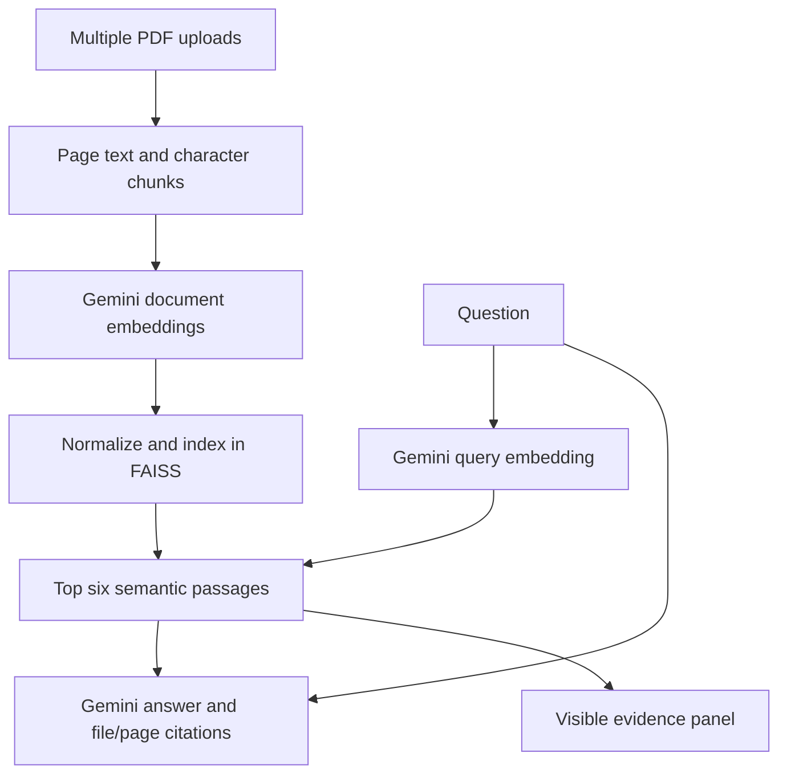

# Architecture

Each page is split into 1,500-character windows advancing by 1,300 characters. Empty pages are skipped. Source filename and one-based PDF page number accompany every chunk. Embedding batches contain at most 20 chunks. RETRIEVAL_DOCUMENT and RETRIEVAL_QUERY task types distinguish document and query encoding with gemini-embedding-001.

Both vectors are normalized, so IndexFlatIP ranking corresponds to cosine similarity. The shared index returns min(6, index.ntotal) chunks, which can all come from one document. Metadata stays in a parallel Python list. Session state holds the index, chunks and upload-selection fingerprint.

A client request has a 60,000 ms timeout and one configured attempt. Generation uses gemini-flash-lite-latest and a 1,000-token output limit. The alias may resolve to a newer model later. The last three successful conversation turns are bounded to 1,500 characters per user turn and 3,000 per assistant turn. With history, Gemini first rewrites the new question into a standalone retrieval query. The answer request also receives bounded history for reference resolution; only retrieved PDF text is factual evidence. Each answer retains passages and its search question in session state. A separate evidence tab lets users revisit prior answers. The shared index is unchanged by chat clearing.

Data sent to Google includes all extracted chunk text for embedding, each question for query embedding, and the retrieved passages plus question for generation. The portfolio hosts a case study, not this Python application.

## Upload identity

Duplicate filenames receive document-number labels. Each chunk retains a document ID, file label and page. Changing upload bytes or names invalidates readiness. Empty-text files are identified after successful processing; entirely empty collections are rejected. Embedding results are checked for matching row count, finite values and nonzero norms before indexing.
